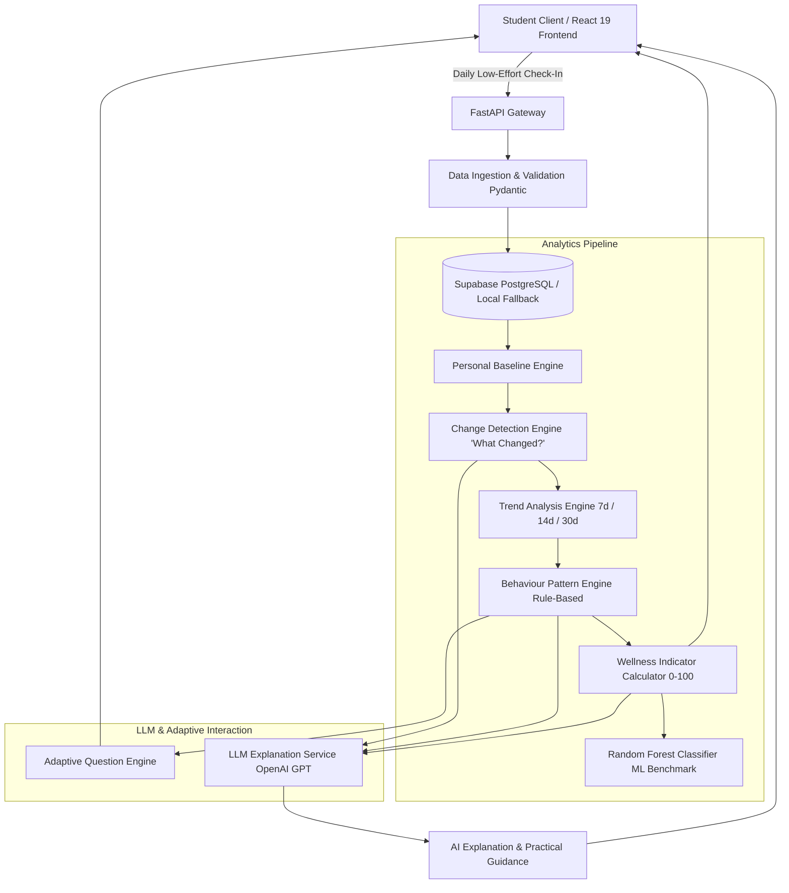

# System Architecture: AI-Based Student Mental Wellness Detection

> **Notice:** Educational wellness-support prototype. Not a medical diagnostic tool.

---

## 1. High-Level Architecture Overview

The system operates as a software-only, privacy-conscious student wellness analytics platform. It replaces repetitive, intrusive surveys with low-effort check-ins, calculates personal baselines, flags meaningful behavioral deviations, categorizes patterns, provides secondary Random Forest benchmark scoring, and uses an LLM to generate plain-language explanations.

---

## 2. Core Modules & Engine Breakdown

### 2.1 Personal Baseline Engine
Instead of enforcing arbitrary fixed medical thresholds (e.g., "everyone must sleep 8 hours"), the system computes an individual baseline using historical rolling medians and robust spread measures across:
- `sleep_hours`
- `study_hours`
- `screen_time`
- `exercise`
- `social_interaction`
- `mood` (1–5)
- `stress` (1–5)
- `academic_pressure` (1–5)

### 2.2 What Changed? Engine
Computes explicit signed deltas between current daily check-in readings and the student's personal baseline:
$$\Delta = \text{Current Value} - \text{Baseline Value}$$
Generates clear human-readable delta indicators (e.g., "Sleep ↓ 2.0h, Study ↑ 3.0h, Stress ↑ 2").

### 2.3 Trend Analysis Engine
Evaluates statistical momentum across 7-day, 14-day, and 30-day windows:
- **Improving** (stress declining, mood rising, sleep stabilizing)
- **Stable** (values remain within personal normal band)
- **Increasing Concern** (consistent consecutive increases in stress/screen time or decline in sleep)

### 2.4 Behaviour Pattern Engine
Evaluates multi-variable lifestyle combinations against college life scenarios:
1. **Academic Workload:** Study ↑, Academic pressure ↑, Sleep ↓, Stress ↑
2. **Digital Lifestyle:** Screen time ↑, Sleep ↓, Exercise ↓
3. **Reduced Social Interaction:** Social interaction ↓, Mood ↓, Stress ↑
4. **Sleep Disruption:** Sleep ↓, Screen time ↑, Stress ↑
5. **Balanced Behaviour:** Stable sleep, moderate study, low stress, regular activity

### 2.5 Secondary Machine Learning (Random Forest)
A Random Forest Classifier trained on structured student behavioral records to classify overall wellness concern tier:
- *Low wellness concern*
- *Moderate wellness concern*
- *Higher wellness concern*

Provides full evaluation metrics (Accuracy, Precision, Recall, F1-Score, Confusion Matrix).

### 2.6 LLM Explanation & Safety Guard
Receives structured analytical JSON payloads from the backend. The prompt strictly instructs the LLM to:
- Explain what changed based solely on computed deltas.
- Highlight the detected behavioral pattern.
- Offer 2–3 practical college lifestyle suggestions (e.g., study timeboxing, evening screen wind-down).
- Maintain absolute non-clinical boundaries (no diagnosis, no psychiatric labels, immediate crisis support contact cards if extreme distress is flagged).

---

## 3. Technology Stack Justification

| Technology | Role | Justification |
|---|---|---|
| **Python** | Backend & ML Runtime | Simple syntax, rich ecosystem for data science (Pandas, NumPy, Scikit-learn). |
| **FastAPI** | REST API Framework | High-performance asynchronous framework, automatic interactive OpenAPI docs (`/docs`), strong typing with Pydantic. |
| **React + Vite** | Frontend Dashboard | Component-driven architecture, instantaneous hot-module replacement, high responsiveness for dynamic charts. |
| **Recharts** | Data Visualizations | Composable SVG chart library ideal for radar fingerprints, time-series trends, and score gauges. |
| **Supabase PostgreSQL** | Relational Database | ACID compliant, structured relational models for time-series check-ins, foreign keys, row security. |
| **Scikit-learn** | Random Forest | Interpretable ensemble classifier suited for tabular behavioral data. |
| **OpenAI GPT API** | Natural Language Layer | Natural phrasing of analytical insights and personalized adaptive questions; invoked only through backend environment variables. |
