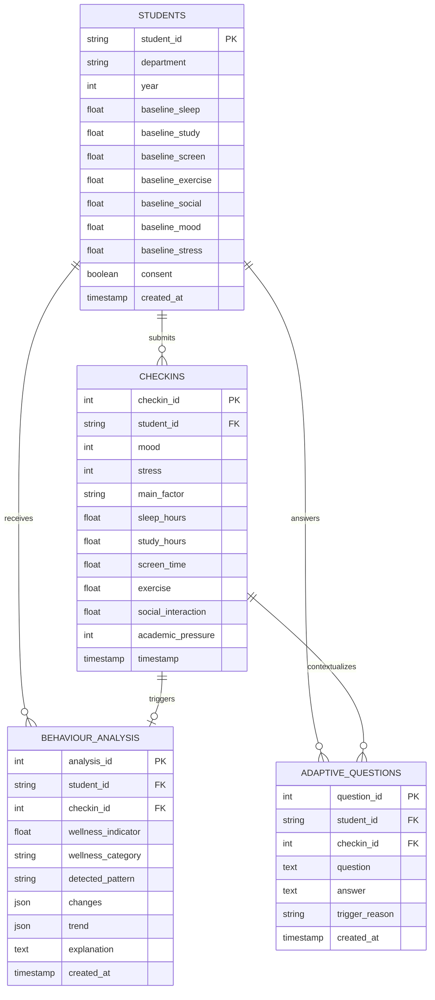

# Database Architecture: AI-Based Student Mental Wellness Detection

> **Engine:** Supabase PostgreSQL (with zero-setup SQLite fallback for local offline demonstrations)  
> **ORM:** SQLAlchemy 2.0 with Pydantic V2 Schemas

---

## 1. Relational Schema Diagram



---

## 2. Table Specifications

### 2.1 Table: `students`
Stores minimal student academic context and initial baseline reference metrics.
```sql
CREATE TABLE students (
    student_id VARCHAR(64) PRIMARY KEY,
    department VARCHAR(128),
    year INTEGER CHECK (year >= 1 AND year <= 5),
    baseline_sleep FLOAT DEFAULT 7.5,
    baseline_study FLOAT DEFAULT 3.0,
    baseline_screen FLOAT DEFAULT 3.0,
    baseline_exercise FLOAT DEFAULT 1.0,
    baseline_social FLOAT DEFAULT 3.0,
    baseline_mood FLOAT DEFAULT 4.0,
    baseline_stress FLOAT DEFAULT 2.0,
    consent BOOLEAN NOT NULL DEFAULT FALSE,
    created_at TIMESTAMP WITH TIME ZONE DEFAULT CURRENT_TIMESTAMP
);
```

### 2.2 Table: `checkins`
Stores daily low-effort check-in logs and detailed behavioral inputs.
```sql
CREATE TABLE checkins (
    checkin_id SERIAL PRIMARY KEY,
    student_id VARCHAR(64) NOT NULL REFERENCES students(student_id) ON DELETE CASCADE,
    mood INTEGER NOT NULL CHECK (mood >= 1 AND mood <= 5),
    stress INTEGER NOT NULL CHECK (stress >= 1 AND stress <= 5),
    main_factor VARCHAR(64),
    sleep_hours FLOAT,
    study_hours FLOAT,
    screen_time FLOAT,
    exercise FLOAT,
    social_interaction FLOAT,
    academic_pressure INTEGER CHECK (academic_pressure >= 1 AND academic_pressure <= 5),
    timestamp TIMESTAMP WITH TIME ZONE DEFAULT CURRENT_TIMESTAMP
);
CREATE INDEX idx_checkins_student_date ON checkins(student_id, timestamp);
```

### 2.3 Table: `behaviour_analysis`
Stores results generated by the Baseline, Trend, and Pattern engines.
```sql
CREATE TABLE behaviour_analysis (
    analysis_id SERIAL PRIMARY KEY,
    student_id VARCHAR(64) NOT NULL REFERENCES students(student_id) ON DELETE CASCADE,
    checkin_id INTEGER REFERENCES checkins(checkin_id) ON DELETE CASCADE,
    wellness_indicator FLOAT CHECK (wellness_indicator >= 0 AND wellness_indicator <= 100),
    wellness_category VARCHAR(64),
    detected_pattern VARCHAR(128),
    changes JSONB,
    trend JSONB,
    explanation TEXT,
    created_at TIMESTAMP WITH TIME ZONE DEFAULT CURRENT_TIMESTAMP
);
CREATE INDEX idx_analysis_student ON behaviour_analysis(student_id);
```

### 2.4 Table: `adaptive_questions`
Stores contextually triggered follow-up questions when unusual deviations are detected.
```sql
CREATE TABLE adaptive_questions (
    question_id SERIAL PRIMARY KEY,
    student_id VARCHAR(64) NOT NULL REFERENCES students(student_id) ON DELETE CASCADE,
    checkin_id INTEGER REFERENCES checkins(checkin_id) ON DELETE SET NULL,
    question TEXT NOT NULL,
    answer TEXT,
    trigger_reason VARCHAR(128),
    created_at TIMESTAMP WITH TIME ZONE DEFAULT CURRENT_TIMESTAMP
);
```

---

## 3. Privacy & Data Handling Principles
1. **Zero Personally Identifiable Information (PII):** No names, email addresses, phone numbers, or social handles are recorded.
2. **Explicit Consent Gate:** No check-in records are persisted without `consent = true`.
3. **Cascade Deletion:** Invoking `DELETE /students/{student_id}` immediately removes all foreign key records in `checkins`, `behaviour_analysis`, and `adaptive_questions`.
